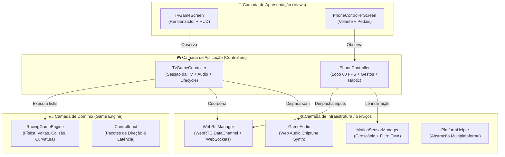

<p align="center">
  <h1 align="center">🏎️ RETRO RACING TV 🏁</h1>
  <p align="center">
    <strong>Jogo de corrida retrô estilo anos 90 (OutRun & Top Gear) em Flutter Web</strong><br>
    Jogue na <strong>Smart TV</strong> usando seu <strong>smartphone como volante com giroscópio</strong> via <strong>WebRTC P2P</strong> de ultra-baixa latência!
  </p>
</p>

<p align="center">
  
  
  
  
  
</p>

---

## 🕹️ O Que É o Retro Racing TV?

**Retro Racing TV** traz de volta a nostalgia dos arcades clássicos dos anos 90 (*OutRun*, *Top Gear*, *Super Monaco GP*) diretamente no navegador da sua **Smart TV**, transformando qualquer **celular (iPhone ou Android) em um volante interativo com giroscópio**.

Basta abrir a TV, apontar a câmera do celular para o QR Code e acelerar!

---

## ✨ Principais Funcionalidades

- 🏎️ **Motor Gráfico Pseudo-3D Retrô**: Renderização pura em `CustomPainter` baseada no clássico algoritmo de projeção de pistas dos anos 80/90, com colinas, curvas dinâmicas, zebras zebradas, montanhas em parallax e tráfego de rivais a 60 FPS cravados.
- 📱 **Celular como Volante Tátil**: Utiliza a API `DeviceMotion` do navegador móvel com **filtro passa-baixa (EMA)** para eliminar qualquer tremedeira (*jitter*), garantindo direção cirúrgica e suave ao virar o aparelho.
- ⚡ **WebRTC DataChannel P2P Direto**: Comunicação direta entre TV e celular via canais de dados UDP peer-to-peer (latência média de **~2ms** em rede local), com fallback automático e transparente via WebSockets.
- 🔊 **Sintetizador Web Audio Chiptune**: Efeitos sonoros gerados dinamicamente em tempo real (ronco do motor modulado por RPM e velocidade, frenagem de pneus, turbo nitro e batidas) sem carregar nenhum arquivo MP3 externo.
- 📐 **Arquitetura Desacoplada (Clean Code)**: Separação rigorosa entre regras de física/domínio (`RacingGameEngine`), orquestradores de estado (`TvGameController` e `PhoneController`), serviços de transporte (`WebRtcManager`) e views puramente reativas.
- ⌨️ **Modo Teclado para PC/Mac**: Suporte nativo a teclas (WASD / Setas / Espaço / Enter) para testar a qualquer momento direto no computador.

---

## 🏗️ Arquitetura do Projeto (Clean Architecture)

O projeto foi refatorado seguindo boas práticas de **Clean Code**, **SOLID** e separação estrita de responsabilidades:



---

## 🚀 Como Executar

O script `run.sh` automatiza a geração dos certificados SSL locais (necessários para o giroscópio no Safari iOS), a compilação do Flutter Web e a inicialização dos servidores:

```bash
chmod +x run.sh
./run.sh
```

---

## 📱 Como Jogar

1. **Na Smart TV**: Abra o navegador web da TV e acesse `http://SEU_IP:8080`.
2. **No Smartphone**:
   - Aponte a câmera para o QR Code da tela da TV (ou acesse a URL HTTPS com porta `8443`).
   - *No iPhone / Safari*: Aceite a solicitação de **Permissão de Movimento** e toque em *"LIGAR MOTOR & VOLANTE"*.
   - Segure o aparelho na horizontal como um volante de corrida!
3. **Controles na Tela do Celular**:
   - 🔄 **Girar o Celular**: Esterça as rodas do carro na TV.
   - 🟢 **Pedal Verde (Acelerar)**: Acelera o carro (e inicia a largada!).
   - 🔴 **Pedal Vermelho (Freio/Ré)**: Reduz a velocidade e manobra.
   - 🔵 **Botão Nitro**: Impulso insano de velocidade (ultrapassa 350 km/h!).
   - 🎯 **Calibrar Zero**: Zera o centro do volante na posição atual da sua mão.

---

## ⌨️ Controles de Teclado (Mac / PC)

Para desenvolvimento ou testes sem necessidade de celular ou TV:
| Tecla | Ação |
| :--- | :--- |
| `W` ou `Seta Cima` | Acelerar / Disparar Largada |
| `S` ou `Seta Baixo` | Frear / Marcha Ré |
| `A` ou `Seta Esquerda` | Virar para a Esquerda |
| `D` ou `Seta Direita` | Virar para a Direita |
| `Espaço` | Ativar NITRO |
| `Enter` | Iniciar Contagem Regressiva (3... 2... 1... GO!) |

---

## 🧪 Suíte de Testes

Para rodar os testes unitários da física, colisões, serialização e lógica de volta:

```bash
flutter test
```

---

## 📂 Estrutura de Pastas

```text
retro_racing_tv/
├── bin/
│   └── server.dart                   # Servidor HTTP/HTTPS + WebSockets Signaler
├── lib/
│   ├── controllers/                  # Controladores de Aplicação & Estado
│   │   ├── motion_sensor_manager.dart # Leitura e filtro anti-jitter dos sensores
│   │   ├── phone_controller.dart     # Gerenciamento do volante e transmissão
│   │   └── tv_game_controller.dart   # Gerenciamento da sessão TV e sincronização
│   ├── core/
│   │   ├── network/                  # Camada WebRTC DataChannel + Signaler WS
│   │   │   └── webrtc_manager.dart
│   │   └── platform/                 # Abstrações multi-plataforma seguras
│   ├── game/
│   │   ├── engine/
│   │   │   └── racing_game_engine.dart # Motor puro de física, pistas e colisões
│   │   ├── models/                   # Segmentos de pista, tráfego e cenário
│   │   ├── game_audio.dart           # Sintetizador chiptune Web Audio
│   │   ├── retro_painter.dart        # Renderizador gráfico CustomPaint 60 FPS
│   │   └── track_builder.dart        # Construtor procedural da pista retrô
│   ├── models/
│   │   └── control_input.dart        # Modelo de dados de entrada do piloto
│   ├── screens/
│   │   ├── phone_controller_screen.dart # View do Volante no Smartphone
│   │   └── tv_game_screen.dart          # View do Jogo em Tela Cheia na TV
│   └── main.dart                     # Roteador automático baseado em tela/URL
├── web/
│   └── index.html                    # Boilerplate web com filtros de aceleração
├── run.sh                            # Script all-in-one para compilar e rodar
└── pubspec.yaml
```

---

## 📄 Licença

Distribuído sob a licença MIT. Veja `LICENSE` para mais detalhes.

Feito com 💜 e café por **[Gabriel Amat](https://github.com/gabriel-amat)**.
